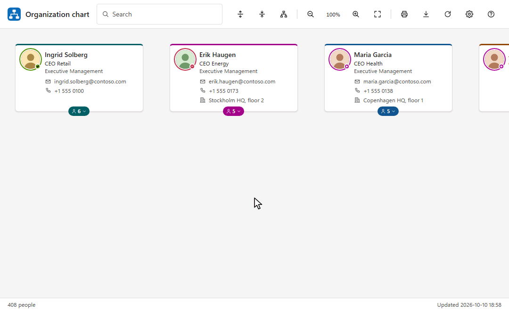

# Organization chart for Microsoft Entra ID

Your organization chart, live from Microsoft Entra ID. A static web app for Azure Static Web Apps (Free plan). It also runs in Microsoft Teams, in SharePoint and on other sites. There is no server: the browser reads Microsoft Graph as the signed-in user. A demo mode needs no Azure account.



## Features

**The chart**

- Live from Entra ID through Microsoft Graph, with profile photos and Teams status.
- Several people at the top, side by side. Each area has its own colour.
- Click a card to unfold its team and open the person's details. Zoom, fit to screen, expand all or collapse all.
- Long teams show 50 people at a time, with a **Show more** button.
- Warnings on cards: no manager set, manager not shown, circular manager chain. The people with each warning are grouped under a heading.
- Opens at the top, at your own card or where you left off. A link to a person opens on them.
- Levels ("Level 1", "Level 2") on cards and in the details, off by default.
- The status bar shows how many people are in the chart and when the directory was read. Reload from the directory at any time.

**People**

- Details: e-mail, phones, office, location, company, employee ID, manager, reporting line, department path and direct reports.
- Presence: Teams status and status message, automatic reply, work location today (office, remote or time off), local time, working hours and when the person is next free.
- Chat, call or e-mail anyone, or copy a link to them. On phones, the link goes to the share sheet.
- Your organization's own fields, such as a cost centre or an extension attribute, in the details.
- Disabled accounts, guests and unlicensed accounts are marked in the details.

**Teams and departments**

- A Team section for every manager: people, levels, managers, departments and cities.
- The whole team, or its people in one department or city, as a list or a photo board. Narrow the list by name, job title or department.
- Chat, e-mail or meet with the direct reports or a whole team. Where there are too many addresses for one link, copy them.
- Show one team alone.
- Departments: their hierarchy, worked out from who reports to whom. As a list, as a chart and in each person's details.

**Search**

- Search like a phone book: name, job title, department, company, office, city, country, e-mail address, phone number and your own fields.
- Before you type, the search lists you, your manager and the people you opened lately.
- **Show all** lists every match beside the chart.

**Directory quality**

- Filters: disabled accounts, guests, unlicensed accounts, people without a manager, people whose manager is not shown, circular manager chains, people without a job title, people hidden from the address list, and people outside the top persons' teams. Everyone can change them in Settings.
- Directory health report, with a list of people for each issue:
  - no manager, a disabled or missing manager, or a circular manager chain;
  - no job title, department, office, e-mail address, phone or photo;
  - a department spelled in two ways, placed inside itself, or split over several places.
- Each list can be shown in the chart, copied as e-mail addresses or exported.

**Export and print**

- Export to CSV: contact details, manager, level, team size, account state and issues for everyone in the chart.
- Print the chart as it is unfolded, with photos.

**Appearance**

- Light, dark and high-contrast themes. In Teams, the chart follows the Teams theme.
- Three text sizes.
- Your title, logo, favicon, font and colours.
- Works on phones: the chart becomes an outline and the panels a bottom sheet.

**Where it runs**

- On its own site.
- In Microsoft Teams: as a personal app, and as a tab in channels, chats and meetings. A tab can show one department.
- In SharePoint: as a web part that signs people in through SharePoint, or in an Embed web part.
- On other sites, in an iframe. The page can pass its colours and leave out the logo, search, toolbar or status bar.

**Fast and private**

- Repeat visits are fast: the directory is kept in the browser and refreshed with only the changes.
- Sign out, or **Forget this browser's copy**, deletes everything the chart kept in the browser.

**Help and support**

- Help explains the chart, the keyboard and the marks on the cards.
- **About this chart** gives your IT support the facts they ask for, without naming anyone.
- Help and error messages link to your support desk.

**Accessibility**

- Full keyboard control: arrow keys, Home and End, typing a name, `*` to unfold a level, `/` to search.
- Screen reader support, built to WCAG 2.2 AA.

## Quick start

1. Install [Node.js](https://nodejs.org) 22 (22.22.2 or later), 24 (24.15 or later) or 26.
2. In `public/config.json`, set `"dataSource": "demo"`. Don't commit this change: the pipeline deploys the file as it is committed.
3. Run `npm install`, then `npm run dev`.
4. Open http://localhost:5173.

The demo shows a fictitious company. You are signed in as Åse Vik.

## Deploy

### 1. Create the Azure resources

You need a Static Web App and an app registration. The script creates both.

Requirements: [PowerShell 7.2 or later](https://learn.microsoft.com/powershell/scripting/install/installing-powershell) and the [Azure CLI](https://learn.microsoft.com/cli/azure/install-azure-cli). It runs on Windows, macOS and Linux.

1. `az login`
2. `pwsh scripts/setup-azure.ps1 -Name orgchart`

The script creates the Static Web App and the app registration. It sets the redirect URIs and the [permissions](#permissions) and grants admin consent. It prints the values for step 2 and a deploy command. Options: `-Location` (default `westeurope`), `-ResourceGroup` (default `rg-<name>`) and `-LocalDev` (see [Development](#development)).

Or do it in the Azure portal:

1. Create a Static Web App. Plan: **Free**. Deployment source: **Other**. Note its host name.
2. Entra ID > App registrations > **New registration**. Choose *Accounts in this organizational directory only*.
3. Authentication > **Add a platform** > *Single-page application*. Add two redirect URIs:
   - `https://<host>/redirect.html`
   - `brk-multihub://<host>` (for Teams, Outlook and microsoft365.com)
4. API permissions > Microsoft Graph > Delegated. Add the [permissions](#permissions), then **Grant admin consent**.

### 2. Configure

In `public/config.json`, set the data source, the app registration's IDs and the people at the top:

```json
"dataSource": "graph",
"auth": { "tenantId": "<directory (tenant) ID>", "clientId": "<application (client) ID>" },
"chart": { "topPersons": ["ceo@contoso.com"] }
```

[docs/examples](docs/examples) has complete files to start from:

| File | For |
|---|---|
| [config.minimal.json](docs/examples/config.minimal.json) | The least a tenant needs. Everything else takes its default. |
| [config.full.json](docs/examples/config.full.json) | Every key, with an example value. |
| [config.private.json](docs/examples/config.private.json) | As little data as possible: no Teams status or calendars, no copy in the browser, no export or health report. |
| [config.demo.json](docs/examples/config.demo.json) | The fictitious company, without sign-in. |

Copy one to `public/config.json` and replace the all-zero IDs. The app refuses them. Every key is described under [Configuration](#configuration).

### 3. Publish

Use the pipeline (below), or deploy from your machine in PowerShell:

```powershell
$env:SWA_CLI_DEPLOYMENT_TOKEN = az staticwebapp secrets list --name <name> --resource-group <resource group> --query properties.apiKey --output tsv
npm run deploy
```

### Azure DevOps pipeline

`azure-pipelines.yml` runs on every push to `main`. It lints, tests and builds the site, deploys it, and packages the Teams and SharePoint apps. Changes to the README and `docs/` alone don't start a run.

1. Pipelines > Library: create the variable group `OrganizationChart` with two variables:
   - `deploymentToken`: the Static Web App's deployment token. Mark it secret.
   - `siteHost`: the site's host name, such as `orgchart.contoso.com`.
2. In `azure-pipelines.yml`, set `teamsDeveloper` to your organization's name. Teams shows it as the app's developer.
3. Pipelines > New pipeline > Azure Repos Git > this repository > **Existing Azure Pipelines YAML file** > `/azure-pipelines.yml`.
4. Run it. Allow it to use the variable group and the `production` environment.

Each run publishes three artifacts: `site`, `teams-app` and `sharepoint-app`.

To check pull requests, add the pipeline as a build validation policy on `main`. Those runs build and test but don't deploy.

## Microsoft Teams

The Teams app opens the deployed site. Its package holds the site's host name and the app registration's client ID, so each organization builds its own.

1. Get the package `orgchart-teams.zip`: the `teams-app` artifact of a pipeline run, or build it yourself. The build needs `auth.clientId` in `public/config.json`:

   ```
   npm run package:teams -- --host <host> --developer "<organization>"
   ```

2. Teams admin center > Teams apps > Manage apps > Actions > **Upload new app**. Upload the zip.
3. Add the app in Teams: as a personal app for the whole organization, or as a tab in a channel, chat or meeting. A tab can show one department: **Choose people** picks the people at its top.

Upload the package again only when the manifest changes: host, title, accent colour, client ID or developer name. The pipeline can't publish the app: Microsoft Graph lets only a signed-in administrator do that.

For your own icons, add `teams/color.png` (192x192) and `teams/outline.png` (32x32, white on transparent) before packaging.

## SharePoint

There are two ways to show the chart on a SharePoint page:

- The **Organization chart** web part. It signs people in through SharePoint, so they never see a sign-in. It needs the package below.
- The **Embed** web part. It needs no package. Where the browser blocks third-party cookies (Safari, Firefox), the chart asks people to sign in about once a day.

### Organization chart web part

1. Get the package `organization-chart.sppkg`: the `sharepoint-app` artifact of a pipeline run, or build it yourself. The build needs Node.js 22:

   ```
   npm ci --prefix sharepoint
   npm run package:sharepoint -- --host <host>
   ```

2. SharePoint admin center > More features > Apps > **Open**. Upload the package and enable it for all sites.
3. SharePoint admin center > Advanced > **API access**, as a Global Administrator. Approve `User.Read.All`. Also approve `Presence.Read.All` and `Calendars.ReadBasic` if you want Teams status and working hours. SharePoint grants these permissions to all its web parts, not to this one alone.
4. Edit a page and add the **Organization chart** web part. To show a team or filters, paste the code from the chart's Settings > **Embed this chart** into the web part's settings. The settings can also hide the logo and title, the search, the toolbar or the status bar. They can use the site's theme colour and the section's background (both on by default).

Upload the package again only when the host, the title or the web part changes.

### Embed web part

1. As a site collection administrator, on the root site: Settings > Site information > View all site settings > **HTML Field Security**. Allow iframes from `<host>`.
2. Open the chart on its own site. Set it up (filters, a team) and copy the code from Settings > **Embed this chart**. Or use this code:

   ```html
   <iframe src="https://<host>/?theme=light" title="Organization chart" width="100%" height="800" style="border:0"></iframe>
   ```

3. Edit a page, add a one-column section and an **Embed** web part. Paste the code.

### Other sites

Any site listed in `embedding.allowedSites` can embed the chart with the same iframe code. [URL parameters](#url-parameters) set the team, the filters, the page's colours and the parts to leave out.

## Configuration

`public/config.json` is read when the chart opens. A change needs a deploy but no rebuild. The one exception is `embedding.allowedSites`, which the build writes into the site's security policy. Errors on screen name the key. Keys that start with `_` are ignored.

| Key | Default | Description |
|---|---|---|
| `dataSource` | `"graph"` | `graph`, or `demo` for a fictitious company |
| `auth.tenantId`, `auth.clientId` | | The app registration's IDs |
| `chart.topPersons` | `[]` | The people at the top, side by side: e-mail address, UPN or object ID |
| `chart.hide` | See [Filters](#filters) | Who the chart hides at first |
| `chart.expandDepth` | `1` | Levels unfolded at start (0-10). With several top persons, the chart starts folded |
| `chart.startAt` | `"top"` | Where the chart opens: `top`, `me` or `lastView` |
| `chart.showPhotos` | `true` | Profile photos; initials otherwise |
| `chart.showPresence` | `true` | Teams status, status message and automatic reply |
| `chart.showWorkLocation` | `true` | Work location today: office, remote or time off |
| `chart.showWorkingHours` | `true` | Local time and working hours |
| `chart.showLevels` | `false` | "Level 1", "Level 2" and so on, on cards and in the details |
| `contact.emailClient` | `"mailto"` | `mailto` opens the mail app; `outlookWeb` opens Outlook on the web |
| `account.changePhotoUrl` | `"https://myaccount.microsoft.com/"` | The **Change profile photo** link in Settings. `""` removes it |
| `support.url` | | Your support desk, as an `https:` or `mailto:` address. Help and error messages link to it |
| `support.label` | `"Contact your IT support"` | The support link's text |
| `directory.cacheInBrowser` | `true` | Keep the directory and photos in the browser between visits |
| `directory.refreshAfterMinutes` | `60` | Refresh a copy older than this in the background |
| `directory.extraFields` | `[]` | See [Organization fields](#organization-fields) |
| `export.enabled` | `true` | The CSV export |
| `export.csvSeparator` | `","` | `";"` for Excel in countries where the decimal separator is a comma |
| `reports.enabled` | `true` | The directory health report |
| `embedding.allowedSites` | `["https://*.sharepoint.com"]` | Sites that may embed the chart. Teams and Microsoft 365 always may. Applied at build time |
| `theme` | `"auto"` | `auto`, `light`, `dark` or `contrast` |
| `language` | `"auto"` | `auto` or `en`. English is the only language so far |
| `branding` | | See [Branding](#branding) |

People can change the filters, the theme, the text size, the levels and where the chart opens for themselves in Settings.

### Filters

`chart.hide` sets which people the chart hides at first.

| Rule | Hidden by default | Who |
|---|---|---|
| `withoutManager` | Yes | People without a manager, with their teams |
| `withHiddenManager` | Yes | People whose manager is not shown, with their teams |
| `inManagerCycle` | Yes | People in a circular manager chain |
| `disabledAccounts` | Yes | Disabled accounts |
| `guests` | Yes | Guests |
| `unlicensed` | Yes | Accounts without a license |
| `withoutJobTitle` | No | People without a job title |
| `hiddenFromAddressList` | Yes | People hidden from the address list (`showInAddressList` in Graph). Above a team, a card without a name keeps their place |
| `unattached` | No | Everyone outside the top persons' teams |

### Branding

```json
"branding": {
  "title": "Contoso organization chart",
  "logoUrl": "/branding/logo.svg",
  "logoUrlDark": "/branding/logo-white.svg",
  "logoAlt": "Contoso",
  "faviconUrl": "/branding/favicon.ico",
  "fontFamily": "'Segoe UI', sans-serif",
  "colors": { "accent": "#0f548c", "headerBackground": "#ffffff", "headerText": "#242424" },
  "darkColors": { "accent": "#479ef5" }
}
```

- Put your files in `public/branding/`, or use `https://` addresses. The repository ships a generic logo and favicon there.
- Colours: `accent`, `headerBackground`, `headerText`, `background`, `surface`, `text`, `mutedText`, `border` and `connector`. `darkColors` applies to the dark theme. The high-contrast theme ignores branding.
- An empty `title` shows the logo alone. `logoAlt` then names it for screen readers.
- The browser console warns about colours with too little contrast.

### Organization fields

```json
"directory": {
  "extraFields": [
    { "property": "employeeOrgData.costCenter", "label": "Cost centre", "search": true, "export": true },
    { "property": "onPremisesExtensionAttributes.extensionAttribute3", "label": "Badge number" }
  ]
}
```

- `property` is one of `employeeType`, `employeeOrgData.division`, `employeeOrgData.costCenter`, or `onPremisesExtensionAttributes.extensionAttribute1` to `extensionAttribute15`.
- Each field is a row in the details. `search` adds it to Search, `export` to the CSV.
- Everyone who can open the chart sees these values. Check what a field holds before you list it.

## URL parameters

| Parameter | Example | Effect |
|---|---|---|
| `top` | `?top=anna@contoso.com,erik@contoso.com` | Only these people's teams |
| `team` | `?team=anna@contoso.com` | One team, with a **Show everyone** button |
| `person` | `?person=anna@contoso.com` | Opens on this person (the Link button's link) |
| `depth` | `?depth=2` | Levels unfolded at start (0-10) |
| `theme` | `?theme=dark` | `auto`, `light`, `dark` or `contrast` |
| `lang` | `?lang=en` | The language. English is the only one so far |
| `show` | `?show=withoutManager,guests` | Shows groups the [filters](#filters) hide |
| `hide` | `?hide=withoutJobTitle` | Hides groups the filters show |
| `without` | `?without=logo,toolbar` | Leaves out the `logo` and title, the `search`, the `toolbar` or the `statusBar` |
| `background`, `accent` | `?background=faf9f8&accent=0078d4` | The embedding page's colours, used where the text stays readable |

People are named by e-mail address, UPN or object ID. For example, everyone without a manager, for a clean-up: `https://<host>/?show=withoutManager`.

## Permissions

Delegated Microsoft Graph permissions, with admin consent:

| Permission | For | Required |
|---|---|---|
| `User.Read.All` | People, managers and photos | Yes |
| `Presence.Read.All` | Teams status | No |
| `Calendars.ReadBasic` | Local time and working hours | No |

## Privacy

- There is no server. The browser reads Microsoft Graph as the signed-in user and keeps a copy of the directory for the next visit. Sign out, or **Forget this browser's copy** in Settings, deletes the copy.
- Anyone who can open the chart sees what the Microsoft 365 people card shows. The filters tidy the chart; they don't hide data. Anyone can switch them off, the address list filter included.
- The CSV export and the directory health report put everyone's contact details in one file. Turn them off with `export.enabled` and `reports.enabled`.

## Development

| Command | Does |
|---|---|
| `npm run dev` | Development server on http://localhost:5173 |
| `npm test` | Tests |
| `npm run lint` | Lint, including the layer rules |
| `npm run typecheck` | Type check |
| `npm run build` | Build into `dist/` |
| `npm run preview` | Serve `dist/` on http://localhost:4173 |
| `npm run deploy` | Build and deploy with the Static Web Apps CLI |
| `npm run package:teams -- --host <host>` | The Teams package, in `teams/build` |
| `npm run package:sharepoint -- --host <host>` | The SharePoint package, in `sharepoint/solution` (Node.js 22) |

To develop against your own tenant, use a separate app registration with the redirect URI `http://localhost:5173/redirect.html`. The setup script creates one with `scripts/setup-azure.ps1 -Name orgchart-dev -LocalDev`, with a Static Web App of its own. Never add that URI to the production registration: a server on that port of a user's machine could receive the user's tokens.

## License

[MIT](LICENSE). Free to use, change and share, as long as the copyright notice naming System Admins stays with it.
